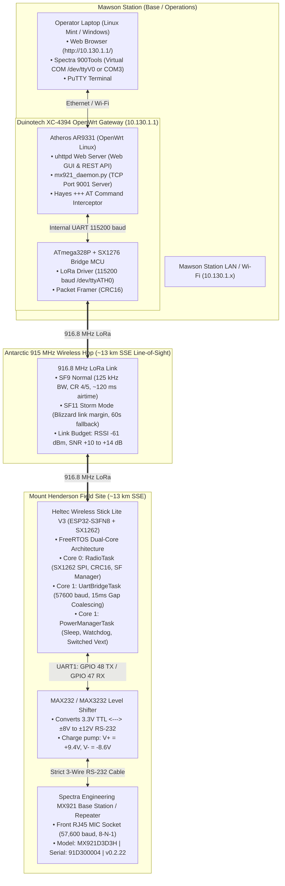
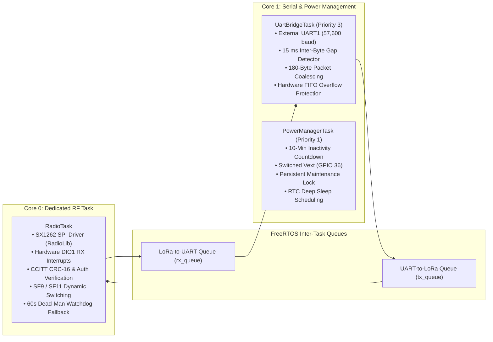
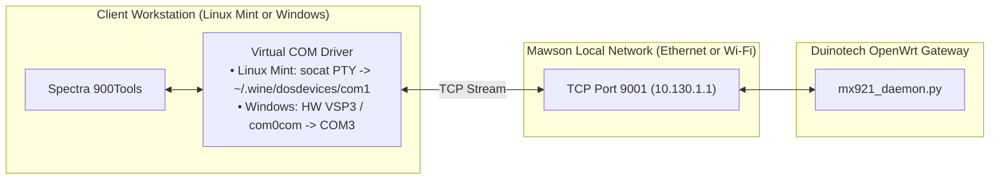
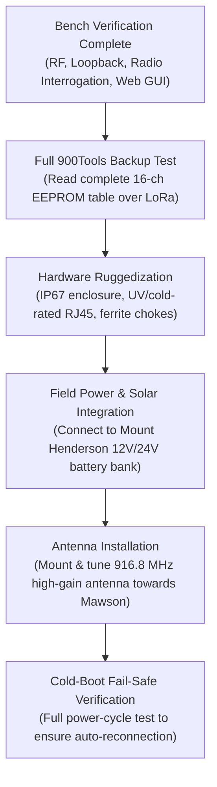

# Mawson MX921 Transparent RS-232-over-LoRa Wireless Bridge

[](https://github.com/rossdem699/MawsonLoRa)
[](https://github.com/rossdem699/MawsonLoRa)
[](https://github.com/rossdem699/MawsonLoRa)
[](https://github.com/rossdem699/MawsonLoRa)

A robust, bidirectional 915 MHz transparent RS-232-over-LoRa wireless serial bridge connecting a **Spectra Engineering MX921 base station/repeater** (front RJ45 `MIC` port at Mount Henderson, ~13 km SSE line-of-sight from Mawson Station, Antarctica) to an **OpenWrt Duinotech XC-4394 LoRa gateway** over Mawson Station Ethernet and Wi-Fi.

---

## 1. System Architecture & Complete Signal Path



---

## 2. Hardware Wiring & Pinout Reference (Bench Verified)

### Front RJ45 MIC Socket Interface (Spectra MX921)
The MX921 front panel `MIC` socket provides a true RS-232 serial interface at **57,600 baud, 8 data bits, no parity, 1 stop bit (8-N-1)**.

> [!CAUTION]
> **Isolation Required:** Pins 1, 2, 3, 4, and 6 **must be left completely disconnected and isolated**. Connecting them risks shorting the repeater's +8V/+12V microphone bias line or accidentally pulling the PTT (Push-To-Talk) line to ground, which would key the transmitter continuously.

```text
========================================================================================
MX921 Front RJ45 Socket           Signal Type         MAX232 Level Shifter
========================================================================================
RJ45 Pin 5 (GND)          <-----> Signal Ground <---> MAX232 Pin 15 (GND)
RJ45 Pin 7 (Radio TXD)    ------> RS-232 Data   ---> MAX232 Pin 13 (R1IN)
RJ45 Pin 8 (Radio RXD)    <------ RS-232 Data   <--- MAX232 Pin 14 (T1OUT)

RJ45 Pin 1 (Mic In / Audio)     --> NOT CONNECTED (ISOLATED)
RJ45 Pin 2 (PTT Line)           --> NOT CONNECTED (ISOLATED)
RJ45 Pin 3 (+8V / +12V DC Bias) --> NOT CONNECTED (ISOLATED)
RJ45 Pin 4 (Aux Logic / NC)     --> NOT CONNECTED (ISOLATED)
RJ45 Pin 6 (Hook / Monitor)     --> NOT CONNECTED (ISOLATED)
========================================================================================
```

### MAX232 to Heltec Wireless Stick Lite V3 (ESP32-S3)
```text
MAX232 Pin 11 (T1IN)    <---> Heltec GPIO 48 (TX1, 3.3V TTL)
MAX232 Pin 12 (R1OUT)   <---> 10k Resistor <---> Heltec GPIO 47 (RX1, 3.3V TTL)
MAX232 Pin 15 (GND)     <---> Heltec GND
MAX232 Pin 16 (VCC)     <---> Heltec 3.3V or Switched Vext (GPIO 36)
```

**Measured Voltage Rails (Verified on Bench):**
* $V_{CC}$: `+3.30 V`
* $V+$ (Pin 2): `+9.41 V`
* $V-$ (Pin 6): `-8.62 V`
* $T1OUT$ (Pin 14 idle mark state): `-8.42 V` (true RS-232 compliant)

---

## 3. Why We Run FreeRTOS (Dual-Core Firmware Architecture)

The remote Heltec node runs **FreeRTOS on the ESP32-S3FN8** for deterministic real-time scheduling. This architecture is vital for RS-232-over-LoRa bridging:



### Why FreeRTOS is Essential:
1. **Preventing UART FIFO Overflow During LoRa Airtime:**
   * At `SF9` (125 kHz BW), transmitting a 180-byte packet takes **~200 ms to 300 ms** of continuous RF airtime.
   * During this transmission window, the SX1262 SPI bus is completely occupied.
   * At 57,600 baud, the MX921 can output **5,760 bytes/second**. The ESP32 hardware UART FIFO is only 128 bytes deep and would overflow in ~22 ms if the CPU were blocked in a single-threaded loop.
   * FreeRTOS allows `UartBridgeTask` on Core 1 to continuously drain the UART ring buffer into FreeRTOS queues while Core 0 handles the radio transmission.
2. **Deterministic Inter-Byte Gap Coalescing:**
   * `UartBridgeTask` uses a **15 ms silence detector** to group bursts of serial characters into single atomic LoRa packets, matching the natural packet framing of `900Tools` and VT100 menus.

---

## 4. Why `RMENU` is Challenging vs. Why `900Tools` is Superior

Bench testing thoroughly interrogated the MX921 via terminal and identified distinct operational characteristics:

### The Pitfalls of `RMENU` (Terminal Menu)
1. **Strict Carriage Return Delimiter (`\r` vs `\r\n`):**
   * The MX921 UART expects **strictly Carriage Return (`\r`, ASCII 0x0D)** as its command terminator.
   * Standard terminal programs (PuTTY, minicom) often send CRLF (`\r\n`).
   * When `\r\n` is sent, the radio executes the command on `\r`, and immediately evaluates the trailing `\n` (ASCII 0x0A) as an empty command, which instantly aborts the menu:
     ```text
     ERROR: Invalid command -> 
     ```
2. **The 30-Second Inactivity Watchdog:**
   * The MX921 firmware has a hardcoded ~30-second inactivity watchdog in `rmenu` to prevent technicians from locking base station CPU routines in the field.
   * If no key is received within 30 seconds, it silently drops to the root CLI. Once outside the menu, pressing menu letters like `E` or `C` produces:
     ```text
     ERROR: Invalid command -> E
     ```
3. **Half-Duplex LoRa Collisions with Manual Typing:**
   * LoRa round-trip latency is ~500 ms. If a technician hesitates while reading menu options, the session times out.
   * Attempting to send background "keep-alive" pings over half-duplex LoRa risks packet collisions if the user types at the same moment.
4. **VT100 Escape Sequences:**
   * Pressing `ESC` in PuTTY sends `\x1b`. If followed by Enter, the radio receives `^[` and prints `ERROR: Invalid command -> ^[`.

### Why `900Tools` is the Preferred Engineering Tool
* **Stateless Machine-to-Machine Protocol:** `900Tools` does **not** navigate `rmenu`. Instead, it communicates via direct, atomic machine commands (request/response memory block queries).
* **Immune to Timeouts:** Because it never enters `rmenu`, the 30-second watchdog never triggers.
* **Full Repeater Control:** Reads and writes complete EEPROM blocks, 16-channel tables, CTCSS subtone matrices, IF/discriminator alignment, and alarm thresholds.

---

## 5. Virtual COM Port Architecture & Linux Considerations

`900Tools` is a Windows 32-bit application designed for standard Windows COM ports (`COM1`–`COMx`). To run it over our network bridge:



### Linux Mint Implementation (via Wine & `socat`)
1. Create a bidirectional virtual serial PTY linked to the Duinotech gateway:
   ```bash
   socat pty,link=/tmp/ttyMX921,raw,echo=0 tcp:10.130.1.1:9001 &
   ```
2. Map the virtual PTY into Wine's DOS devices directory:
   ```bash
   ln -s /tmp/ttyMX921 ~/.wine/dosdevices/com1
   ```
3. Launch `900Tools` inside Wine and select `COM1`.

### Challenges When Running on Linux:
* **Wine Serial Latency Handling:** `900Tools` was written for local hardware UARTs with sub-millisecond latency. Over a 916.8 MHz LoRa hop, latency is ~250–500 ms. If `900Tools` exhibits timeout alerts, the Communications Timeout setting in `900Tools` must be increased to **1500 ms – 2000 ms**.
* **PTY Lifetime:** If the network drops or `socat` terminates, the PTY link `/tmp/ttyMX921` breaks and must be cleanly re-established before restarting Wine.
* **Windows Alternative:** On a native Windows laptop, **HW VSP3 (HW Virtual Serial Port)** or **com0com** creates a driver-level virtual `COM3` that handles network reconnects automatically.

---

## 6. Lightweight Web Control Bar & REST API (`http://10.130.1.1/`)

To eliminate the need for PuTTY or complex terminal setups during routine checks, a mobile-friendly Web GUI is served directly from the Duinotech gateway (`/www/`):

* **Smart Atomic Transactions:** Replaces slow manual menu typing. Clicking **"Read Identity"** or **"Read Channel 1"** triggers an atomic 1-second burst (`rmenu\r` $\rightarrow$ `E\r` $\rightarrow$ `1\r`), displays the data, and exits cleanly before the 30-second watchdog can fire.
* **Real-Time Visual Progress Bar:** Displays `TX ➔ LoRa ➔ MX921 ➔ RX` state changes so operators never stare at a blank unresponsive terminal.
* **Mobile-Optimized Touch Grid:** Minimum 48px touch targets, iOS 16px font-protection against auto-zoom, and responsive layout for field tablets and smartphones.
* **One-Click Diagnostic Quick Buttons:** Standalone buttons for `rmenu`, `Enter ⏎`, `ESC (Back)`, `Channel 1`, and `Read Configuration`.

---

## 7. What is Left to Do (Field Deployment Roadmap)

Bench testing at Mawson Station is **100% complete and verified**. The following tasks remain before and during deployment to Mount Henderson (~13 km SSE):



1. **Full `900Tools` EEPROM Backup Test:**
   * Perform a complete "Read All Channels" and "Save Archive (.mx9)" using `900Tools` over the LoRa link to ensure large multi-packet blocks transfer without CRC failures.
2. **Outdoor Weatherproofing & Cabling:**
   * Fabricate a cold-rated, shielded RJ45 patch cable (0.5–1 m) with dual snap-on ferrite chokes to prevent VHF RF ingress into the serial lines.
   * House the Heltec WSL V3 and MAX232 PCB inside an IP67 sealed junction box suitable for Antarctic conditions (-30°C to -40°C windchill).
3. **Power System Integration at Mount Henderson:**
   * Connect Heltec $V_{in}$ to the hut’s solar/wind battery bank via an isolated DC-DC converter (12V/24V $\rightarrow$ 5V).
   * Verify switched $V_{ext}$ deep-sleep current draw (~1 mA) in sub-zero temperatures.
4. **Antenna Mounting & Link Margin Verification:**
   * Mount a directional 915 MHz Yagi or high-gain collinear antenna on the Mt Henderson mast pointed line-of-sight toward Mawson Station.
   * Verify link budget maintains $\ge 25\text{ dB}$ fade margin under severe weather conditions.
5. **Cold-Boot & Power-Cycle Testing:**
   * Power-cycle both the Duinotech gateway and Heltec remote node simultaneously to verify that all daemons, SPI radios, and UART tasks resume and establish communications with zero manual intervention.
