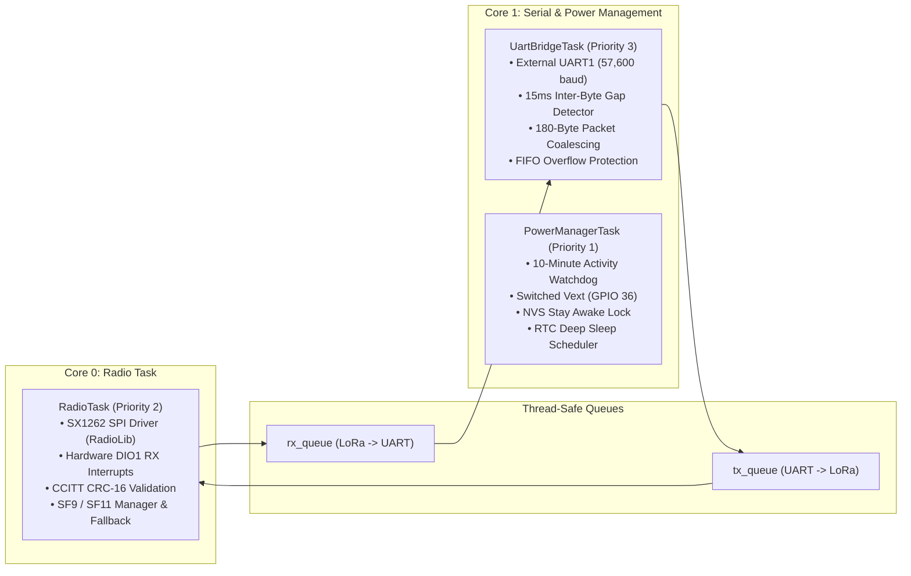

# Mawson MX921 Transparent RS-232-over-LoRa Bridge — Phased Workflow & Engineering Guide

> **Current Specification:** [`SPEC.md`](./SPEC.md)  
> **Session Checkpoint:** [`CHECKPOINT.md`](./CHECKPOINT.md)  
> **Repository Overview:** [`README.md`](./README.md)  
> **Historical Archive (Superseded Concept):** [`MawsonLoRaRepeaterESP32.md`](./MawsonLoRaRepeaterESP32.md)

---

## 1. Project Overview & Evolution

This project provides a robust, bidirectional **915 MHz transparent RS-232-over-LoRa wireless serial bridge** connecting an off-site **Spectra Engineering MX921 base station / repeater** at Mount Henderson (~13 km SSE line-of-sight from Mawson Station, Antarctica) to an **OpenWrt Duinotech XC-4394 LoRa gateway** over Mawson Station Ethernet and Wi-Fi.

### Evolution from Early Concepts
* **Previous Exploratory Concept (Superseded):** Early project iterations explored tapping the rear DB9 `CN4` and DB25 `CN3` sockets with custom optocouplers, analog RSSI dividers, and a multi-tab web dashboard attempting to reverse-engineer telemetry signals.
* **Current Production Design (Verified):** We transitioned to a clean, transparent **bidirectional RS-232 serial bridge over LoRa** interfacing the MX921’s front panel **RJ45 `MIC` socket**. This provides a native virtual COM pipe for the manufacturer's official **Spectra `900Tools`** software and VT100 interactive console (`RMENU`), supplemented by a fast, mobile-friendly Web GUI hosted directly on OpenWrt.

---

## 2. System Architecture & End-to-End Signal Path

```mermaid
flowchart TD
    subgraph MawsonBase ["Mawson Station (Base / Operations)"]
        direction TB
        Operator["Operator Laptop / Mobile Phone<br/>• Spectra 900Tools (Virtual COM /dev/ttyV0 or COM3)<br/>• Mobile Web GUI (http://10.130.1.1/)<br/>• PuTTY / Terminal Console"]
        LAN["Local Network: Ethernet Cable OR Wi-Fi (duinotech-18094a)"]
        
        subgraph Duinotech ["Duinotech XC-4394 Gateway (OpenWrt Linux @ 10.130.1.1)"]
            AR9331["Atheros AR9331 SoC<br/>• uhttpd Web Server (Mobile Web GUI & REST API)<br/>• mx921_daemon.py (TCP Port 9001 Server)<br/>• Hayes +++ AT Command Interceptor"]
            AVR["ATmega328P + SX1276 Bridge MCU<br/>• Transparent LoRa Driver (/dev/ttyATH0 @ 115200 baud)<br/>• Minimal RAM Footprint (427B SRAM, 20.8%)"]
            AR9331 <-->|Internal Serial UART @ 115200 baud| AVR
        end
        Operator <-->|TCP / HTTP| LAN <-->|10.130.1.1| AR9331
    end

    subgraph RFHop ["915 MHz LoRa Wireless Hop (~13 km SSE Line-of-Sight)"]
        LoRa["916.8 MHz LoRa Link<br/>• SF9 Normal: ~120 ms airtime, <500 ms RTT (900Tools compatible)<br/>• SF11 Storm Mode: High fade margin for blizzards (60s dead-man fallback)<br/>• Bench Measured: RSSI -61 dBm, SNR +10 to +14 dB, 0 CRC errors"]
    end

    subgraph MtHenderson ["Mount Henderson Field Repeater Site (~13 km SSE)"]
        direction TB
        Heltec["Heltec Wireless Stick Lite V3 (ESP32-S3FN8 + SX1262)<br/>• FreeRTOS Dual-Core Architecture<br/>• Core 0: RadioTask (SX1262 SPI, CRC16, SF Manager)<br/>• Core 1: UartBridgeTask (57600 baud, 15ms Gap Coalescing)<br/>• Core 1: PowerManagerTask (Sleep, Watchdog, Switched Vext)"]
        
        MAX232["MAX232 / MAX3232 Level Shifter<br/>• 3.3V TTL <---> ±8V to ±12V RS-232<br/>• Charge pump: V+ = +9.4V, V- = -8.6V"]
        
        MX921["Spectra Engineering MX921 Repeater<br/>• Model: MX921D3D3H (VHF 148–174 MHz, 50W)<br/>• Serial: 91D300004 | Firmware: v0.2.22<br/>• Front RJ45 MIC Socket @ 57,600 baud (8-N-1)"]
        
        Heltec <-->|UART1: GPIO 48 TX / GPIO 47 RX| MAX232
        MAX232 <-->|Strict 3-Wire Interface| MX921
    end

    AVR <== "916.8 MHz LoRa" ==> LoRa
    LoRa <== "916.8 MHz LoRa" ==> Heltec
```



---

## 3. Hardware Interface & Wiring Reference (Bench Verified)

### Front RJ45 MIC Socket Interface (Spectra MX921)
The MX921 front panel `MIC` socket provides a true RS-232 serial interface at **57,600 baud, 8-N-1**.

> [!CAUTION]
> **Pins 1, 2, 3, 4, and 6 must be isolated and disconnected.**  
> Connecting these pins risks shorting the repeater's +8V/+12V microphone bias line or pulling PTT to ground, which would key the transmitter continuously.

```text
========================================================================================
MX921 Front RJ45 Socket           Signal Type         MAX232 Level Shifter
========================================================================================
RJ45 Pin 5 (GND)          <-----> Signal Ground <---> MAX232 Pin 15 (GND)
RJ45 Pin 7 (Radio TXD)    ------> RS-232 Data   ---> MAX232 Pin 13 (R1IN)
RJ45 Pin 8 (Radio RXD)    <------ RS-232 Data   <--- MAX232 Pin 14 (T1OUT)

RJ45 Pin 1 (Mic In / Audio)     --> NOT CONNECTED (ISOLATED)
RJ45 Pin 2 (PTT Line)           --> NOT CONNECTED (ISOLATED)
RJ45 Pin 3 (+8V / +12V DC Bias) --> NOT CONNECTED (ISOLATED)
RJ45 Pin 4 (Aux Logic / NC)     --> NOT CONNECTED (ISOLATED)
RJ45 Pin 6 (Hook / Monitor)     --> NOT CONNECTED (ISOLATED)
========================================================================================
```

### MAX232 to Heltec Wireless Stick Lite V3 (ESP32-S3)
```text
MAX232 Pin 11 (T1IN)    <---> Heltec GPIO 48 (TX1, 3.3V TTL)
MAX232 Pin 12 (R1OUT)   <---> 10k Resistor <---> Heltec GPIO 47 (RX1, 3.3V TTL)
MAX232 Pin 15 (GND)     <---> Heltec GND
MAX232 Pin 16 (VCC)     <---> Heltec 3.3V / Switched Vext (GPIO 36)
```

**Measured Voltage Rails (Bench Verified):**
* $V_{CC}$: `+3.30 V`
* $V+$ (Pin 2): `+9.41 V`
* $V-$ (Pin 6): `-8.62 V`
* $T1OUT$ (Pin 14 idle mark state): `-8.42 V` (compliant RS-232 mark state)

---

## 4. Why FreeRTOS is Used (Firmware Architecture)

The remote Heltec node runs **FreeRTOS on the ESP32-S3FN8**:



### Technical Rationale:
1. **Preventing UART FIFO Overflow During LoRa Transmissions:**
   * At `SF9` (125 kHz BW), transmitting a 180-byte packet takes **~200 ms to 300 ms** of radio airtime.
   * During this time, the SPI bus and SX1262 transceiver are completely occupied.
   * At 57,600 baud, incoming data arrives at 5.76 kB/s. The ESP32 hardware UART FIFO is only 128 bytes deep and would overflow in ~22 ms if the system were single-threaded.
   * FreeRTOS isolates `UartBridgeTask` on **Core 1** to continuously drain the UART ring buffer into FreeRTOS queues while Core 0 transmits over LoRa.
2. **Deterministic Packet Framing:**
   * `UartBridgeTask` uses a **15 ms inter-byte silence detector** to group incoming serial streams into coherent atomic packets, matching the natural packet framing of `900Tools` and VT100 menus.

---

## 5. Engineering Findings: `RMENU` vs. `900Tools`

### Challenges with `RMENU` (Terminal Menu)
* **Strict Carriage Return Delimiter (`\r` vs `\r\n`):** The MX921 UART requires **strictly `\r` (0x0D)**. Sending `\r\n` causes the trailing `\n` to be evaluated as a second empty command, immediately aborting menus with `ERROR: Invalid command -> `.
* **30-Second Inactivity Watchdog:** The MX921 firmware automatically exits `rmenu` after ~30 seconds of inactivity to protect against technician lockouts. Once closed, typing menu choices returns `ERROR: Invalid command -> E`.
* **Latency & Half-Duplex Collisions:** Over LoRa, interactive human typing feels sluggish (~500 ms round trip). Sending background keep-alive pings over half-duplex LoRa is dangerous because pings collide with manual keystrokes.

### Why `900Tools` is Superior
* **Stateless Machine Protocol:** Uses direct, atomic command-response frames (memory block dumps and parameter writes).
* **Zero Timeout Risk:** Never enters `rmenu`; therefore, the 30-second watchdog never activates.
* **Comprehensive Control:** Reads and writes full 16-channel tables, CTCSS matrices, IF/discriminator alignment, and saves codeplug archive files (`.mx9`).

---

## 6. Virtual COM Port & Linux Setup

`900Tools` is a 32-bit Windows application expecting a hardware COM port (`COM1`–`COMx`).

* **On Linux Mint (Wine + `socat`):**
  1. Create virtual serial PTY linked to the Duinotech:
     ```bash
     socat pty,link=/tmp/ttyMX921,raw,echo=0 tcp:10.130.1.1:9001 &
     ```
  2. Map into Wine's DOS devices:
     ```bash
     ln -s /tmp/ttyMX921 ~/.wine/dosdevices/com1
     ```
  3. Launch `900Tools` under Wine, selecting `COM1`.
* **Linux Timing Adjustment:** `900Tools` assumes local hardware UART response times. Across the LoRa bridge (~500 ms round trip), the Communications Timeout setting in `900Tools` must be relaxed to **1500 ms – 2000 ms** to prevent premature timeout alerts.
* **Windows Alternative:** On Windows laptops, **HW VSP3** or **com0com** creates a driver-level virtual `COM3` pointing directly to `10.130.1.1:9001` with built-in auto-reconnect.

---

## 7. Phased Workflow & Progress Checklist

### Phase 1: Physical Layer & RF Link — COMPLETE & VERIFIED
- [x] **1.1. 915 MHz RF Hardware Verification**
  - Confirmed hardware is 916.8 MHz (863–928 MHz HF).
  - Attached bench antennas / U.FL-to-SMA pigtails.
- [x] **1.2. Shared Packet Protocol Layer**
  - Created [`shared/mx921_packet.h`](./shared/mx921_packet.h) with CCITT CRC-16 hardware validation and 4-byte auth tags.
- [x] **1.3. Duinotech Gateway MCU Bridge**
  - Built and flashed minimal ATmega328P transparent serial-to-LoRa bridge (`gateway_mcu/src/main.cpp`).
  - Verified low memory footprint: 427 bytes SRAM (20.8%).
- [x] **1.4. Heltec WSL V3 RF Driver**
  - Verified full bidirectional ping/ACK exchange between Heltec WSL V3 (SX1262) and Duinotech XC-4394 (SX1276) at 916.8 MHz.

### Phase 2: Transparent RS-232 Bridge & FreeRTOS Firmware — COMPLETE & VERIFIED
- [x] **2.1. Assemble MAX232 Level Shifter Interface**
  - Wired MAX232 charge pump rails (+9.4V V+, -8.6V V-, -8.42V T1OUT).
  - Connected Heltec `GPIO 48 (TX)` and `GPIO 47 (RX)` with 10k protection resistor.
- [x] **2.2. Dual-Core FreeRTOS Firmware Implementation**
  - Implemented `RadioTask` (Core 0) and `UartBridgeTask` (Core 1) with 15 ms idle-gap coalescing in [`node_mx921/src/main.cpp`](./node_mx921/src/main.cpp).
- [x] **2.3. End-to-End Serial Loopback Verification**
  - Bridged RJ45 Pins 7 & 8 on the bench harness.
  - Verified bidirectional serial round-trip over LoRa at 57,600 baud with **0 CRC errors**.

### Phase 3: Live MX921 Repeater Interrogation — COMPLETE & VERIFIED
- [x] **3.1. Front RJ45 MIC Socket Connection**
  - Connected Pin 5 (GND), Pin 7 (TXD), Pin 8 (RXD) to the Spectra MX921.
  - Isolated Pins 1, 2, 3, 4, 6 to protect +8V mic bias and PTT.
- [x] **3.2. Query Identity & Menu Traversal**
  - Sent `RMENU` over LoRa; successfully extracted:
    - **Model:** `MX921D3D3H` (VHF 148–174 MHz, 50W)
    - **Serial Number:** `91D300004`
    - **Firmware:** `0.2.22`
- [x] **3.3. Interrogate Channel Parameters**
  - Queried Channel 1: Tx `0.00000 MHz`, Rx `0.00000 MHz`, Tx Power `50.0 W`, Duplex, Bandwidth `WIDE`.
  - Confirmed `0.00000 MHz` indicates unprogrammed/blank channel slot.
- [x] **3.4. Resolve Delimiter & Watchdog Behavior**
  - Normalized outgoing line endings to single `\r` (CR) to eliminate menu aborts.
  - Documented 30-second menu inactivity watchdog and VT100 ESC sequence handling.

### Phase 4: OpenWrt Services & Mobile Web GUI — COMPLETE & VERIFIED
- [x] **4.1. OpenWrt Gateway TCP Daemon**
  - Deployed `/root/mx921_daemon.py` listening on TCP Port 9001 with Hayes `+++` AT command parser.
  - Auto-start configured via `/etc/init.d/mx921_daemon`.
- [x] **4.2. Mobile-Friendly Web Dashboard**
  - Deployed to `/www/` and `/www/mx921/`:
    - Real-time LoRa signal metrics (RSSI, SNR, SF).
    - Visual progress bar (`TX ➔ LoRa ➔ MX921 ➔ RX`).
    - Smart atomic query bursts bypassing the 30-second watchdog.
    - Responsive mobile touch grid ($\ge 48\text{px}$ targets) and live serial terminal.
  - Tested mobile connection over Wi-Fi (`duinotech-18094a` at `http://10.130.1.1/`).

### Phase 5: Virtual COM Port & `900Tools` Integration — CURRENT FOCUS
- [ ] **5.1. Obtain Spectra `900Tools` Installer**
  - Locate `900Tools` installer in Mawson/AAD station archives or request password from Spectra Engineering.
- [ ] **5.2. Configure Virtual COM Bridge**
  - Set up `socat` on Linux Mint / Wine (`COM1`) or `HW VSP3` on Windows (`COM3`).
- [ ] **5.3. End-to-End `900Tools` Read/Write Verification**
  - Perform full "Read All Channels" and verify multi-packet EEPROM transfer across the 916.8 MHz LoRa link.
  - Save full repeater codeplug backup (`.mx9`).

### Phase 6: Mount Henderson (~13 km SSE) Field Deployment — UPCOMING
- [ ] **6.1. Environmental Ruggedization**
  - Enclose Heltec WSL V3 and MAX232 in an IP67 weatherproof box with desiccant packs.
  - Install snap-on ferrite chokes on the RJ45 serial patch cable to suppress VHF RF ingress.
- [ ] **6.2. Field Power Supply Integration**
  - Connect Heltec $V_{in}$ to the hut’s solar/wind battery bank (12V/24V) via an isolated 5V DC-DC converter.
  - Verify switched $V_{ext}$ deep-sleep current draw (~1 mA) under freezing temperatures.
- [ ] **6.3. Antenna Mounting & Alignment**
  - Mount directional 915 MHz Yagi or high-gain collinear antenna pointed line-of-sight toward Mawson Station.
  - Sweep antenna with VNA at 916.8 MHz (target VSWR `< 1.5:1`, fade margin $\ge 25\text{ dB}$).
- [ ] **6.4. Cold-Boot & Autonomous Reconnection Test**
  - Simulate complete power loss and restore to verify both ends auto-negotiate and resume the LoRa link with zero human intervention.
